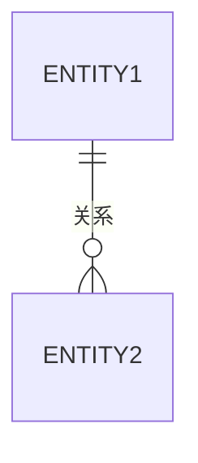
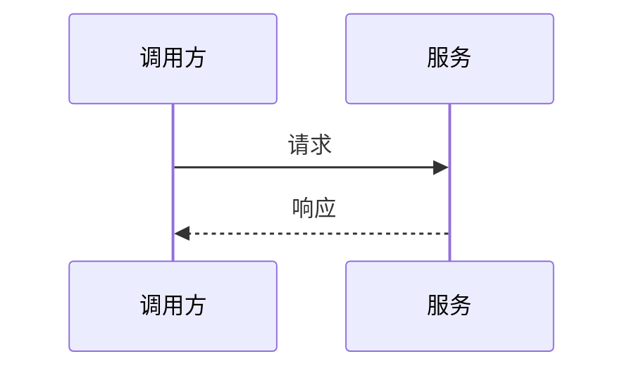

# {业务领域} 系统设计

> 只写实现方案。技术栈与整体关系写技术架构，代码位置与调用关系写代码地图。

## 设计目标

{该领域要实现的目标和约束，一到三句}

## 模块划分

- **{模块}**
  - 职责：{该模块负责什么}
  - 依赖：{依赖哪些模块或外部系统}

## 领域模型

{核心实体、值对象、聚合，用 mermaid 表达关系，不复述字段}

## 数据模型

{表、集合、索引的设计意图和约束，不列字段清单}

## 接口设计

- **{接口名}**
  - 用途：{做什么}
  - 契约：`{METHOD} {path}`
  - 约束：{幂等、鉴权、限流、错误码}

## 关键流程

{用 mermaid 时序图或流程图描述核心流程}

## 设计决策

- **{决策}**：选择 {方案}（而非 {替代方案}），因为 {原因}。

## 外部集成

{依赖的外部系统、协议、失败与重试处理}

## 风险与限制

{已知限制、待解决的设计问题}
